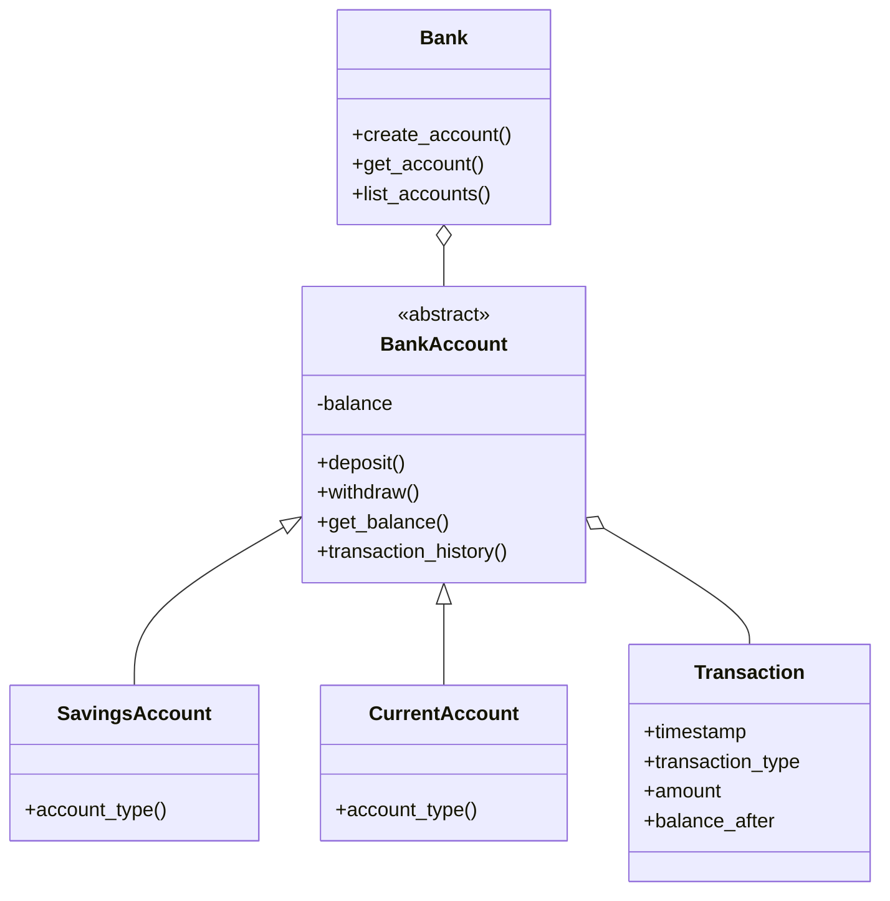

# python-oop-banking-system
python oop banking-system inheritance polymorphism encapsulation abstraction beginner-project
# 🏦 Python OOP Banking System

A beginner-friendly banking application built with Python and Object-Oriented Programming (OOP). This project demonstrates how banking operations can be organized using classes, inheritance, encapsulation, abstraction, and polymorphism.

## 🚀 Features

- 🆕 Create Savings and Current Accounts
- 💰 Deposit Money
- 💸 Withdraw Money
- 📊 Check Account Balance
- 📜 View Transaction History
- 👥 View All Accounts
- 🛡️ Input Validation and Exception Handling
- 🧱 Object-Oriented and Modular Design

## 🛠️ Technologies Used

- Python 3
- Object-Oriented Programming (OOP)
- Abstract Base Classes
- Exception Handling
- Mermaid Class Diagrams

## 📚 OOP Concepts Implemented

- **Classes and Objects:** Organize banking entities and operations.
- **Constructors:** Initialize account and transaction objects.
- **Encapsulation:** Protect account balance through controlled methods.
- **Inheritance:** Extend the base account class.
- **Polymorphism:** Implement account-specific behavior.
- **Abstraction:** Define a common interface for account types.

## 📂 Project Structure

```text
python-oop-banking-system/
├── banking_system.py
├── README.md
└── .gitignore
```

## ⚙️ Installation and Usage

**Step 1:** Install Python 3 from https://www.python.org/downloads/

**Step 2:** Download or clone this repository.

**Step 3:** Open a terminal in the project folder.

**Step 4:** Run the application:

```bash
python banking_system.py
```

**Step 5:** Follow the interactive menu to create accounts, deposit money, withdraw money, and view transaction history.

## 🏗️ Class Architecture



## 🎯 Learning Outcomes

This project helped me practice OOP principles, class relationships, transaction management, input validation, exception handling, and clean code organization.

## 🔮 Future Improvements

- Persistent storage using SQLite
- Automated unit testing
- GUI or web dashboard
- User authentication and authorization
- Improved transaction auditing

## 👨‍💻 Author

**Kamal Dhaka**  
B.Tech Student | Artificial Intelligence & Data Science

## ⭐ Support

If you find this project useful, give the repository a ⭐ and share your feedback!

---

*Built for learning Python OOP and software design fundamentals.*

**Note:** This is an educational simulation, not production-ready banking software. Account data is stored in memory and resets when the program exits.
